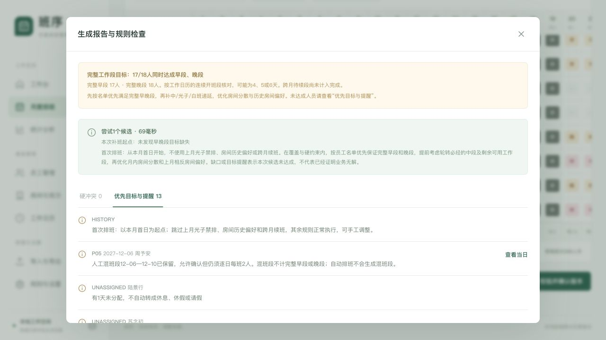
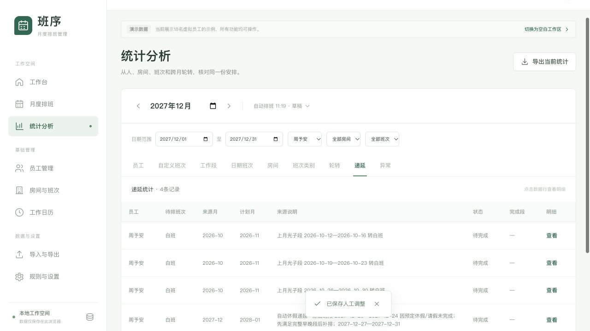

## A 修复与规则

上一版将房间分散放在完整早晚目标之前。
逐日分配也未提前预留剩余工作段和必经中段。
已复现16人正常月份仍有人缺早段的问题。

新顺序为覆盖、名单顺序的完整早晚目标、递延、房间分散、历史偏好。
工作段长度按日历确定，支持4天、6天及其他长度。
部分休假不切段，整段假期不算完成。
跨月未结束段暂不计入完整目标，自动原段先续完。

人工可在同段混班，仍需逐日每班2人。
有明确人工调整依据的混班显示P05，不单独阻止确认。
混班段不计完整早晚目标，也不算递延完成段。
没有人工依据的自动混班仍报H04，自动新增段仍同房间同班。

休假或请假替换原中、光子、白班段时，记录原班段来源。
当月该类别未完成，自动登记下月任务。
同员工、来源月和类别只记一项，说明保留原班段范围。
恢复完整原类别或取消假期后，同步撤销对应自动任务。

## B 自动测试与构建

全量177项自动测试通过。
原有144项继续通过，新增33项回归测试。
生产构建通过，保留ExcelJS原有的大文件体积提示。

| 新增测试 | 项数 | 主要结果 |
| --- | --- | --- |
| 完整早晚段优先 | 10 | 名单顺序、剩余段、中段、容量、历史、假期均覆盖 |
| 休假递延 | 14 | 来源、补排、去重、撤销、JSON与确认后重排均覆盖 |
| 人工混班 | 9 | 首日末日互换、跨房间、跨月、锁定与自动约束均覆盖 |

| 关键场景 | 验证结果 |
| --- | --- |
| 16人、四个完整工作段 | 全部完成早段和晚段，八班各2人 |
| 18人、五个完整工作段 | 全部完成早段和晚段 |
| 18人、四个完整工作段 | 优先保证名单前16人，不能虚增早晚名额 |
| 调休4天、6天段 | 完整段核对正确，休假不切段 |
| 整段休假但仍有可用段 | 优先利用剩余段完成早晚目标 |
| 名单顺序与数组顺序不同 | 以名单顺序优先 |
| 上月使用真实生成结果 | 继续红黄轮转，优先早晚目标 |
| 大量中、光子、白班待排任务 | 不挤占完整早晚目标 |
| 人工整月锁定白班 | 保留原格，报告早0段晚0段 |
| 原中、光子、白段全部请假 | 自动建立唯一有来源任务，并参与下月补排 |
| 部分请假或同月另有完整同类别段 | 不重复欠班 |
| 恢复原段或取消计划 | 自动任务撤销，人工任务保留 |
| 无来源计划及早晚未完成 | 不伪造低优先级欠班 |
| 两人首日或末日对调早中班 | 每天2人，混班仅提醒，无硬冲突 |
| 只改一个人导致1人/3人 | H02仍阻止确认 |
| 自动段内出现不同班 | H04仍为硬冲突 |
| 锁定整段人工混班再生成 | 原格保留，不向该段新增自动混班 |
| 跨月人工对调 | 关联来源的两个月均提示人工例外 |

## C 实际页面验证

页面测试使用独立本地地址，未使用正式业务数据。

**完整早晚段**

18名虚拟员工生成2027年12月。
无上月参考，首段为12月1日至3日。
当月共有五个可结束工作段，全部18人完成早段和晚段。
普通班共368人天，无硬冲突。

**人工混班**

将12月6日周予安的橙中与徐星澜的橙早互换。
其他日期保留原班，逐日八班仍各2人。
页面显示无硬冲突、P05提醒，确认按钮可用。
徐星澜原早段变为混班，因此完整早晚目标变为17/18人。

**休假递延与下月补排**

将周予安12月20日至24日的白班段改为请假。
同月27日至31日仍有完整白班，因此未新增欠班。
再将后一白班段也改为请假，系统建立一项下月白班任务。
来源说明同时保留两段日期，计划月份为2028年1月。

请假后原月草稿存在白班缺口，未将该草稿作为满员结果。
以该来源生成2028年1月，页面无硬冲突。
该月有四个已结束新段，早晚同时达成16/18人。
周予安的实际工作段如下。

| 工作段 | 房间班次 | 完整性 |
| --- | --- | --- |
| 01-03至01-07 | 橙早 | 完整 |
| 01-10至01-14 | 红中 | 完整 |
| 01-17至01-21 | 红晚 | 完整 |
| 01-24至01-28 | 白班 | 完整 |
| 01-31至02-04 | 白班 | 跨月待续 |

任务在确认完整段后才标为完成，草稿中仍为待完成。
测试过程中未发现页面控制台错误。

## D 可复核验收步骤

**场景1：先满足完整早晚目标**

目标：防止房间分散挤占早晚工作段。
前置：16人在职，四个完整工作段，八班启用，无人工锁定。
角色：排班负责人。

1. 选择目标月，重排未锁定格。
2. 打开生成报告。
3. 核对完整早段16人、晚段16人。
4. 核对日期班次表，每班均为2人。

预期：完整早晚目标全部达成，段内班次一致。

**场景2：有来源的休假递延**

目标：正确记录未完成的中、光子或白班目标。
前置：某员工原有完整中班段，同月无其他完整中段。
角色：排班负责人。

1. 将该段全部调整为请假。
2. 打开递延统计，检查来源与下月计划。
3. 生成下月，核对早晚目标及中段补排。
4. 确认有效版本，再检查任务状态。

预期：只登记一项，保留原段日期，确认后标完成。

**场景3：允许人工混班**

目标：人工可对调某一天，自动仍按整段生成。
前置：两名员工同一段分别为早班和中班。
角色：排班负责人。

1. 将甲第一天改为乙的中班。
2. 将乙第一天改为甲的早班。
3. 检查每天配对和生成报告。
4. 锁定整段安排，再测试自动生成。

预期：人数正确时只提醒P05；自动不新增混班。
只改一方造成缺口或超额时，仍报告H02。

## E 验证边界与使用

已有月份需重排未锁定格，才能使用新的目标分配方式。
人工锁定安排仍保留，不能保证所有约束下人人达成。
四个完整工作段的普通八班，早晚各只有16个完整段名额。
容量不足或历史顺序受限时，按名单优先并显示未达成。

未取得真实业务Excel，本次文件验证使用构造文件。
无原班段来源的旧记录不会追溯猜测欠班。
JSON保留完整来源；普通Excel班表不能替代完整备份。
候选搜索不承诺穷尽所有复杂约束的可行解。

执行验证：npm test、npm run build、实际页面操作及git diff检查。
