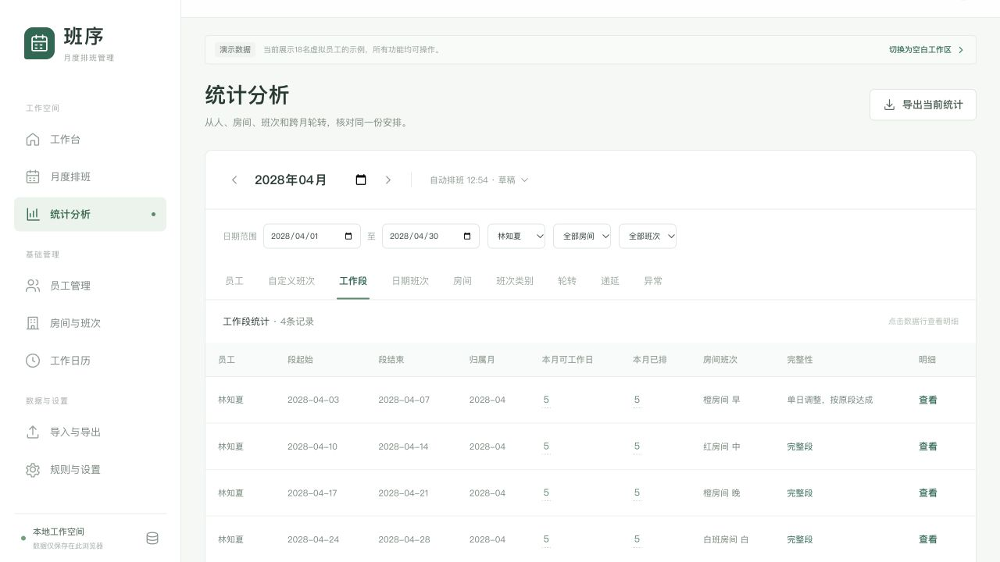
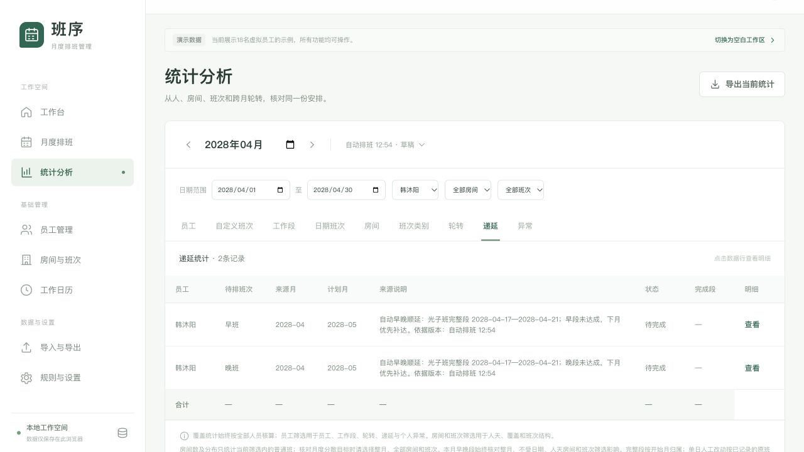
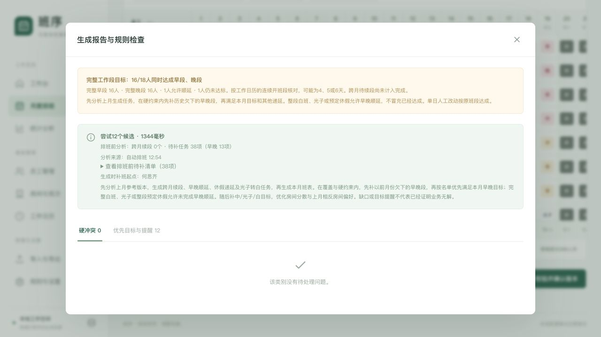
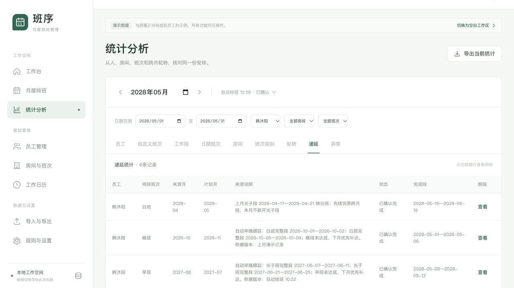

## A 本版实现

自动生成分为历史分析和目标月分配两步。
历史分析先读取上月有效版本与更早的未完成任务。
自动推导跨月续段、早晚顺延、原班段休假递延和光子转白目标。
之后再结合本月日历、预定休假、人工保留格分配班次。

在覆盖与硬约束内，先补历史早晚欠项，再优先完成当月早晚目标。
中、光子、白班任务随后补排，再优化房间分散与历史房间偏好。
报告保存本次分析来源、续段数量和待补清单。
重复生成按固定任务编号去重，不追加重复记录。

当月有整段白班、光子或预定休假时，缺失早晚类别允许顺延。
“允许顺延”与“已达成”分别统计，仍尽量在当月完成。
草稿安排不核销递延，确认版本后才标完成。

仅一天人工调整时，按已记录的原班段类别计达成。
例如原早段变为“中、早、早、早、早”，仍算一个早段。
不会额外算完整中段；人天、每日人数和轮转参照仍按实际班表。
没有原段依据时不按多数猜测；多日混班不套用单日例外。

## B 自动测试与构建

全量200项自动测试通过，覆盖15个测试文件。
本版新增23项专项测试，并更新旧规则验收口径。
生产构建通过，ExcelJS保留原有的大文件体积提示。

| 专项范围 | 核对结果 |
| --- | --- |
| 完整白班、光子与整段预定休假 | 缺失早晚分别建立下月任务，实际达成不虚增 |
| 零散普通班、部分预定休假、整段事后请假 | 不单独产生早晚豁免 |
| 原早、中、晚、白、光子段单日改班 | 只按原类别达成，实际人天保持变化 |
| 两天短段、原段含部分预定休假 | 不按多数猜测，保留原类别与可用日期口径 |
| 连续逐日把整段改为请假 | 保留原始依据，不能误算成只改一天 |
| 两人对调与只改一人 | 人数仍各2时仅提醒；1人与3人仍是H02硬冲突 |
| 自动混班、无原段依据 | 不获得单日原段达成，自动混班仍为H04 |
| 跨月单日调整 | 关联来源两个月均能识别原段达成 |
| 上月未预同步任务 | 生成前直接从有效班表推导并用于分配 |
| 光子跨月尚未结束 | 原段先续完，建立白班任务，禁止新开光子段 |
| 目标月已有确认版本 | 重排时不使用正被替换版本核销本次任务 |
| 重复生成与恢复源目标 | 任务去重，自动任务随来源撤销 |
| JSON恢复与清空副本 | 原段依据保留或移除正确，原版本不受清空影响 |
| Excel导出 | 员工目标、实际矩阵、工作段达成与排班前任务一致 |
| 原有轮转与分配逻辑 | 早中晚循环、每日2人、锁定保护、调休与房间偏好继续通过 |

## C 页面验证：原段达成

使用独立本地测试地址，未操作正式业务工作区。
2028年4月共有18名虚拟员工，普通班320人天，无硬冲突。
实际早晚同时达成16人，另外2人符合顺延条件。

4月3日，将林知夏的橙早与陈明远的橙中对调。
两人的其他日期保持原班，逐日八班仍各2人。
林知夏4月3日至7日显示“单日调整，按原段达成”，类别为橙早。
员工统计为早4天、中6天、晚5天、白5天，出勤仍为20天。
完整早段和晚段仍显示已达成，没有额外增加完整中段。

## D 页面验证：先分析上月再补达

韩沐阳4月有4月17日至21日的完整光子段，但缺早段与晚段。
系统自动建立两项来源为2028年4月、计划为5月的任务。
无需提前手工登记。

生成5月时，报告记录上月来源版本。
本次历史分析有38项待补任务，其中早晚13项。
清单包含4月两位员工的4项早晚任务及其他测试月份的未完成任务。
目标月按这些任务和当前规则生成，无硬冲突，普通班368人天。

5月全表实际早晚同时达成16人，1人允许顺延，1人仍未达标。
这项提示如实保留，没有把允许顺延或未达标算成已达成。
本次候选尝试12次，未宣称所有员工目标都已满足。

| 上月欠项员工 | 5月晚段补达 | 5月早段补达 | 光子转白 |
| --- | --- | --- | --- |
| 韩沐阳 | 5月1日至5日 | 5月8日至12日 | 5月15日至19日 |
| 赵云帆 | 5月1日至5日 | 5月8日至12日 | 5月15日至19日 |

两位员工的4月早晚任务都在5月补达。
确认5月版本后，任务显示“已确认完成”，并关联实际完成段。
未确认的草稿不会被当作已核销。

## E 验收与使用边界

先选择目标月份，再点击自动排班，无需另外生成递延。
来源月份有改动时，应重新生成目标月，重新推导任务。
生成报告的待补清单是生成前快照，当前完成状态以递延统计为准。

硬约束始终优先，历史欠项不会突破每日两人、原段续排和早中晚顺序。
来源为草稿或导入记录时，系统会使用当前有效版本并显示来源。
没有紧邻上月时使用首次排班规则，已有更早递延仍可补达。
复杂约束下可能保留缺口或目标提醒，候选搜索不保证穷尽全部可行解。

Excel增加“工作段达成”和“排班前任务”工作表。
实际班表重新导入不会从混班数据猜测原段类别。
请用完整JSON备份保留原段依据与全部版本记录。

本次没有取得真实业务Excel，文件回归使用构造数据。
本报告替换V1.10中人工混班一律不计完成、早晚不可顺延的旧口径。
PRD、HTML使用说明和验收场景已同步更新。
