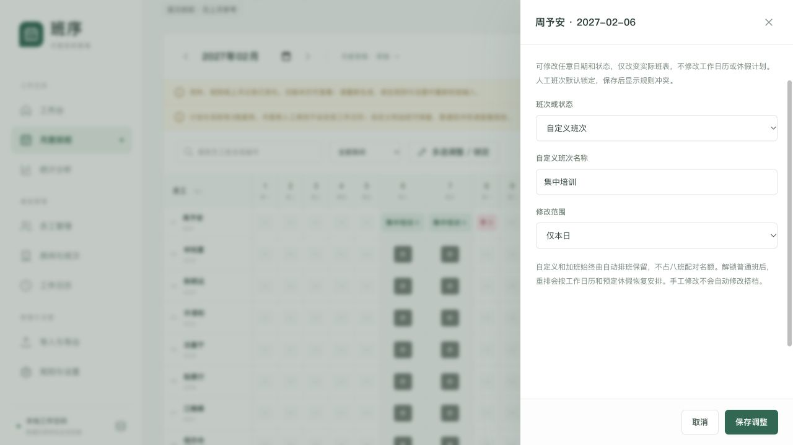

## A 回归结果

本次修改后的104项自动测试全部通过。
构建同时检查TypeScript和Vue模板。
浏览器已验证实际生成、编辑、保存和版本确认流程。
正式业务数据仍需负责人按实际节假日和人员核对。

先对基线运行86项测试，并完成6组定向诊断。
实现后替换与新需求冲突的旧断言，再新增18项边界测试。
测试没有沿用“保护格禁止编辑”等已废止的要求。

## B 自动测试范围

| 测试模块 | 数量 | 覆盖内容 |
| --- | --- | --- |
| 员工初始化导入 | 5 | 编号、同名、更新、日期及错误行 |
| 日期需求配置 | 7 | 单日、批量、休息跳过、恢复默认及快照 |
| 休假计划 | 11 | 独立计划、增删改、实际状态及备份 |
| 月度编辑与清空 | 14 | 全状态选择、批量、锁定、修订及原子失败 |
| 首次排班 | 7 | 无员工、无上月、已有人工安排与初始化 |
| Excel服务 | 12 | 颜色、矩阵、明细、往返及无效输入 |
| 加班 | 11 | 自动保留、撤销、统计、边界与Excel |
| 基础排班 | 19 | 两人、容量、确定性、跨月、光子及统计 |
| V1.7专项 | 18 | 分类别轮换、任意编辑、自定义和加班转换 |
| 合计 | 104 | 全部通过 |

V1.7专项分别验证早、中、晚的相反房间匹配。
同类别先比较累计天数，只有平票时才参考最后一次。
休假改普通班锁定后保留，解锁后两种生成均恢复计划。
自定义占用16人之一时，普通班正确报告15人的缺口。

## C 浏览器实际操作

| 操作 | 观察结果 |
| --- | --- |
| 打开尚无班表的2027年2月 | 显示员工月表，可直接编辑 |
| 周末填写自定义名称 | 首次保存建立草稿，单元格显示名称 |
| 周末改普通班 | 保存成功，默认勾选人工锁定 |
| 多选周末和已有自定义格 | 两格均可选择，批量自定义保存成功 |
| 配置员工预定休假后到月表改普通班 | 月表成功改变，计划表黄色格仍保留 |
| 查看工作日历 | 只有两个页签，开班保存不需要原因 |
| 查看固定规则与自定义统计 | 无规则切换，自定义按名称显示人天 |
| 再次自动生成 | 已锁定改班、自定义均保留，计划冲突仍提示 |
| 解锁计划休假日的普通班后重排 | 恢复黄色预定休假，自定义不变 |
| 缺口与计划冲突消除后检查确认 | 显示无硬冲突，确认按钮可用 |
| 确认后再次编辑自定义名称 | 建立修订草稿，原确认版仍在版本记录 |
| 刷新后重新选择月份 | 已保存自定义、计划和班表仍可查看 |

## D 重点冲突与修复

相反房间是优先目标，不覆盖未结束的跨月原班。
普通班仍需两人，自定义和加班不能抵消普通班缺口。
人工编辑可保存冲突，确认版本仍受硬约束检查。

工作段改为只看开班日历和任职边界。
月度休息、请假、假期、自定义不再反向切段。
计划来源与人工实际状态分离，重排按锁定策略处理。

容量计算包含所有已经保留的普通班安排。
任职期外人工安排仍报错，不能因此再多排普通班人员。

任意状态改加班后，撤销可恢复原班、请假或自定义名称。
有效预定休假仍优先恢复。
清空加班时，原普通班或自定义也一并清除，不重新变为出勤。
相关边界均有自动测试覆盖。

## E 验证方式与范围

自动测试使用 `npm test`。
正式构建使用 `npm run build`。
修改检查使用 `git diff --check`。
浏览器操作使用独立测试地址和虚拟员工，不修改真实业务库。

Excel验证包含月度矩阵和结构化明细两种格式。
自定义名称包含尾部U的样本，确保不被普通班标记清理逻辑截断。
JSON验证包含自定义和加班原状态，恢复后保持相同业务数据。

排班器会搜索多个候选，但不承诺找到所有复杂约束的可行解。
未排满会如实报告缺口，不把超时当作业务无解。
构建保留ExcelJS较大分包的既有提示，不影响构建成功。
