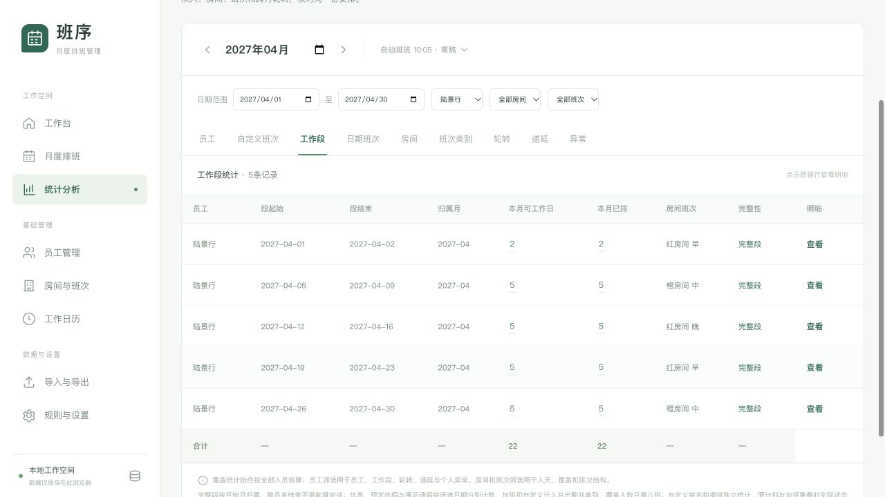

## A 规则与结果

红、黄房间普通班合并按工作段早→中→晚→早循环。
换房间不重置顺序，同一段内仍保持同房间同班。
跨月原段先续完，只在新工作段推进一次。
白班、光子、自定义、加班、整段休假和未分配不推进顺序。

全量120项自动测试通过，其中16项覆盖本次轮转调整。
保留此前104项测试，并更新3个房间偏好样本的前置历史。
这些样本既满足新顺序，也继续验证相反房间偏好。

首次没有进度时错峰起步，满足每日八班各2人。
已有历史时接续最近一次红黄普通班，之后严格循环。
若连续历史月份只排白班，也沿版本链保留之前进度。
缺少紧邻上月时仍按既有首次模式处理，不虚构进度。

## B 自动测试覆盖

| 范围 | 结果 |
| --- | --- |
| 16人、18人整月生成 | 顺序正确、八班各2人、段内同班 |
| 红黄房间切换 | 红早后黄房间也只能中班 |
| 连续早、连续中、连续晚 | 均可识别H07轮转冲突 |
| 4天和6天工作段 | 每段只推进一次 |
| 工作段中有休假 | 不切段，每段仍只推进一次 |
| 白班、光子、自定义和空位穿插 | 不重置普通班进度 |
| 跨月未结束的早段 | 原段续完，新段再到中班 |
| 人工锁定或补空位保留的违序安排 | 保留原格，报告冲突，不自动延长错误班段 |
| 轮到中班但中班停用 | 报告缺口，不用连续早班代替 |
| 日历休息日上的人工普通班 | 不算新工作段，不推进轮转 |
| 旧版本与来源快照 | 旧版不追溯套用新规则；新生成采用新规则 |
| 原有导入、统计、假期、自定义、加班、版本功能 | 全量测试继续通过 |

## C 实际页面验证

排班负责人使用本地18名虚拟员工，选择无历史的2027年4月。
通过“自动排班”生成草稿，页面显示无硬冲突。
进入工作段统计，筛选员工陆景行，得到以下五段。

| 工作段 | 房间与班次 |
| --- | --- |
| 04-01至04-02 | 红房间早班 |
| 04-05至04-09 | 橙房间中班 |
| 04-12至04-16 | 红房间晚班 |
| 04-19至04-23 | 红房间早班 |
| 04-26至04-30 | 橙房间中班 |

## D 可复核验收场景

**场景1：跨房间循环**

目标：确认换房间不会重置早中晚顺序。
前置：员工上一个工作段为红早，下一段可排橙中。
角色：排班负责人。

1. 生成下一个工作段。
2. 查看该员工的工作段统计。
3. 核对下一次红黄普通班类别为中班。

预期：不重复早班，不跳过中班直接安排晚班。

**场景2：跨月原段优先**

目标：确认月初续段不重复推进轮转。
前置：上月底早班工作段尚未结束。
角色：排班负责人。

1. 自动生成下个月。
2. 检查月初延续原房间早班。
3. 检查后一个红黄工作段为中班。

预期：先续完整段，再推进到中班。

**场景3：类别需求无法满足**

目标：确认系统不为填人数而重复同类段。
前置：员工下一次应为中班，但中班停用。
角色：排班负责人。

1. 自动生成目标月。
2. 查看未分配和缺口报告。
3. 检查没有新增连续早班。

预期：如实保留缺口；不得伪装成顺序正确的满员班表。

## E 使用与验证边界

已有班表需重新自动生成，才会采用新顺序。
人工锁定和自定义不会被静默删除。
违序保留安排会在新版本中显示H07，确认前需解决。
早晚目标和相反房间偏好在顺序允许的范围内继续执行。

自动测试运行 `npm test`，构建运行 `npm run build`。
页面验证使用独立测试地址和虚拟员工。
复杂约束仍可能有缺口，系统会报告，不承诺穷尽所有可行解。
