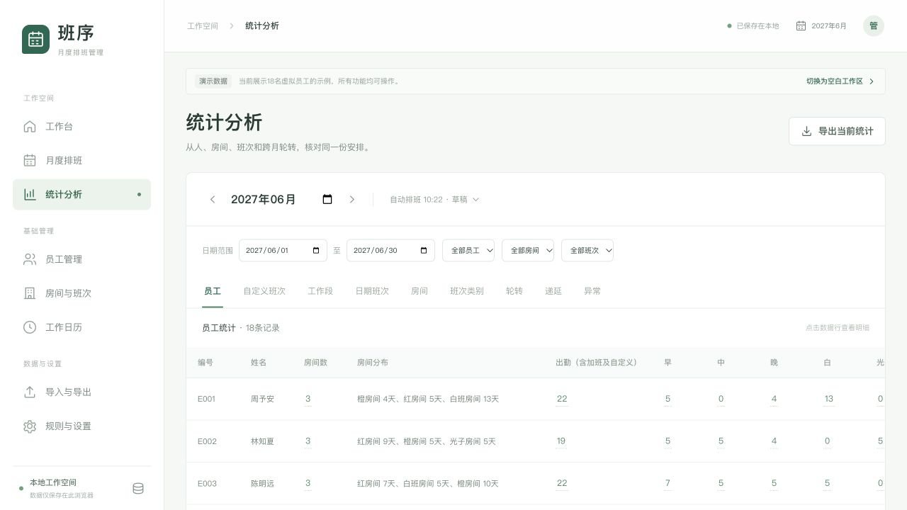

## A 规则与处理顺序

在覆盖和硬约束内，每人当月优先安排至少两个普通班房间。
红、橙、白班和光子按房间ID去重。
同房间从早班改成中班不算换房间。
自定义、加班和不可用状态不算第二个房间。

生成时参考当月已排格及未来保留格，按完整工作段分散。
候选依次比较覆盖、月内房间分散、早晚目标和历史房间偏好。
跨月续班、早中晚顺序、光子禁排和保护格仍优先。
仅补空位仍保留已有普通班；重排可改变未锁定班。

单一房间未达成时报告P04提醒，不伪造排班或拆工作段。
P04不单独阻止确认，硬冲突仍阻止确认。
本目标不要求房间天数均分或每人遍历四个房间。

## B 自动测试与构建

新增24项测试，全量144项自动测试通过。
原有120项测试继续通过，固定规则快照增加新目标标记。
生产构建通过，保留ExcelJS已有的大体积文件提示。

| 场景 | 验证结果 |
| --- | --- |
| 16人与18人正常月份 | 每人至少两个房间，八班各2人，段内同班 |
| 28天、30天、31天及月初不同边界 | 房间分散不破坏轮转和覆盖 |
| 上月早中晚均在红房间 | 月内分散优先于本月全橙偏好 |
| 同房间的早中晚 | 按一个房间统计，未达成提示P04 |
| 白班和光子 | 各计一个房间，仅计当月实际普通班 |
| 自定义、加班、休息、休假、请假和未分配 | 不计房间，也不能虚增分散结果 |
| 整月普通班已锁定 | 两种生成均保留，单一房间提示P04 |
| 后面工作段已锁定 | 前面可调段参考锁定房间，尝试其他房间 |
| 未锁定的整月已有普通班 | 补空位保留，重排可分散 |
| 只开放一个房间 | 保持覆盖，不开额外班，提示P04 |
| 月底任职或预定休假只剩一段 | 不拆段、不覆盖休假，提示P04 |
| 跨月原段未结束 | 先续原房间原班，新段再分散 |
| 旧版本规则快照 | 不追溯套用新提醒，重新生成才使用新目标 |

## C 实际页面验证

在独立测试地址使用18名虚拟员工，生成2027年6月。
该月没有上月参考，按首次排班生成。
月度表显示352普通班人天，无硬冲突。
员工统计中18人均安排到两个或三个房间。

| 员工示例 | 房间数 | 房间分布 |
| --- | --- | --- |
| 周予安 | 3 | 橙房间4天，红房间5天，白班房间13天 |
| 陆景行 | 2 | 橙房间9天，红房间9天 |
| 韩沐阳 | 2 | 红房间7天，光子房间14天 |

房间筛选切到红房间后，房间数只显示0或1。
恢复全部房间后，重新显示整月房间分布。
房间数不在合计行相加，避免把个人去重数当总房间数。
新增列后回归休息日明细，8条休息记录仍正确显示。
重新载入页面后，新班表保留，页面无控制台错误。

## D 可复核验收场景

**场景1：避免历史偏好导致整月单一房间**

目标：月内分散优先于上月相反房间偏好。
前置：员工上月早中晚均为红房间，本月红橙均有需求。
角色：排班负责人。

1. 选择目标月，重排未锁定格。
2. 查看员工的房间数和工作段。
3. 核对至少两个房间及早中晚顺序。

预期：允许部分新段不采用全橙偏好，段内仍保持同班。

**场景2：保护锁定安排**

目标：分散目标不覆盖人工锁定。
前置：某员工当月普通班已全部锁在一个房间。
角色：排班负责人。

1. 生成目标月，查看该员工安排。
2. 在报告的优先目标页检查P04。
3. 解锁允许调整的格子，再选择重排。

预期：锁定时原格保留；解锁后才重新分散。

**场景3：可排条件不足**

目标：不为第二个房间破坏工作段或需求。
前置：只有一个可用工作段，或只开放一个房间。
角色：排班负责人。

1. 生成目标月。
2. 检查段内班次和需求覆盖。
3. 查看P04及假期、需求配置。

预期：如实提示目标未达成，不私自拆段或开额外班。

## E 使用与验证边界

本次测试未使用真实员工资料或真实业务Excel。
房间分散仍通过候选搜索实现，不承诺穷尽所有可行解。
若仍提示P04，请核对限制并调整或重排。
已有版本保留原快照，新目标在重新生成后生效。

自动测试运行 `npm test`，生产构建运行 `npm run build`。
