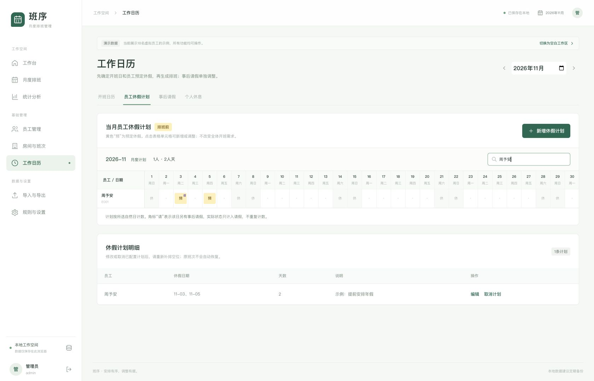
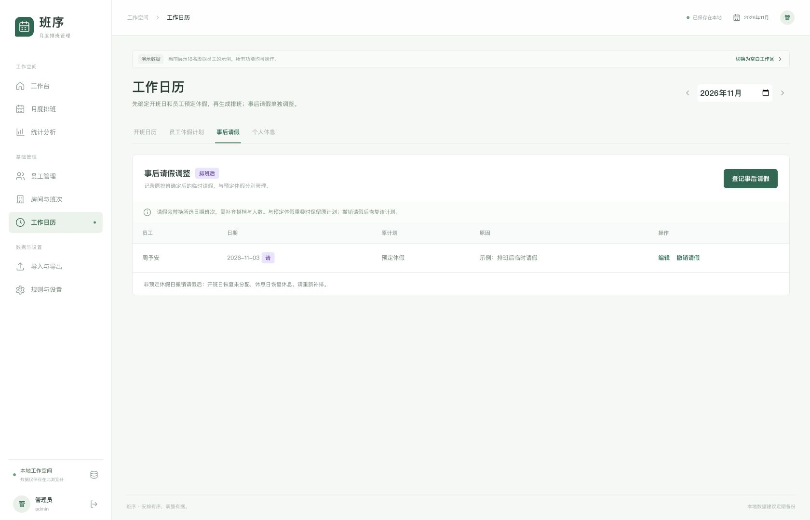
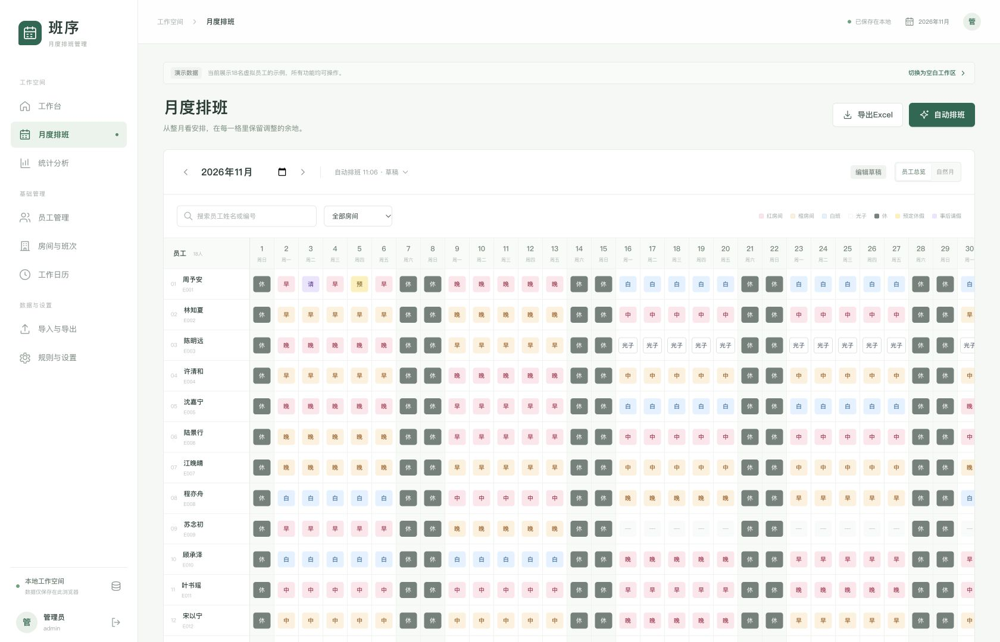

## A 开始使用：打开、登录与认识菜单

```callout info 先记住这三件事
数据保存在当前浏览器中，不会自动同步到其他电脑。
首次打开是空白工作区，可先导入员工名单或已有班表。
有硬冲突的班表可以保存为草稿，但不能确认为有效版本。
```

### 打开系统

1. 打开提供给你的 `scheduling` 项目文件夹。
2. 在macOS中，双击“启动班序.command”。
3. 等待启动窗口显示本地访问地址。
4. 用浏览器打开[班序本地系统](http://127.0.0.1:5178/)。

使用期间保留启动窗口。关闭该窗口会停止访问服务。
若提示缺少运行环境，请联系提供系统的人完成首次配置。
其他操作系统的使用者，请向部署人员索取启动方式。

本说明书可以直接打开阅读，阅读时不需要启动排班系统。

### 登录与退出

| 项目 | 内容 |
| --- | --- |
| 固定账号 | `admin` |
| 固定密码 | `Admin@123456` |
| 快速填写 | 登录页点击“填入” |
| 登录 | 点击“登录工作空间” |
| 退出 | 点击右上角头像，或左下角管理员区域 |

账号与密码区分大小写，输入时不要带入前后空格。
当前页面不提供改密码或多账号管理。
关闭标签页后，再打开时可能需要重新登录。
退出登录不会删除已保存的排班数据。

固定口令用于本地入口管理，不能替代设备本身的访问保护。

### 先熟悉左侧菜单

| 菜单 | 你可以在这里做什么 |
| --- | --- |
| 工作台 | 看本月覆盖、冲突数量、房间人天与常用入口 |
| 月度排班 | 看整月班表、生成草稿、改单元格、查配对、确认版本 |
| 统计分析 | 按人员、日期、房间、班次和轮转核对数据 |
| 员工管理 | 新增、编辑、停用员工，调整名单顺序 |
| 房间与班次 | 修改房间名称与颜色，启用或关闭班次需求 |
| 工作日历 | 调整开班日期，配置预定休假、事后请假和个人休息 |
| 导入与导出 | 下载模板、预览Excel、确认导入、导出班表 |
| 规则与设置 | 明确规则、查看版本、添加递延、备份与恢复 |

窄屏设备先点击左上角菜单按钮，再选择页面。
整月表格较宽时，在表格内部左右滚动。


### 每月推荐操作顺序

```flow LR
核对员工 -> 导入上月: 有历史时
核对员工 -> 登记休假: 没有历史也可继续
导入上月 -> 登记休假: 核对历史
登记休假 -> 生成草稿: 准备目标月
生成草稿 -> 检查与修改: 处理冲突
检查与修改 -> 确认与导出: 核对完成
确认与导出 -> 完整备份: 保留工作区
```

## B 首次准备：真实名单、房间与班次

### 首次打开：选择初始化方式

首次打开没有员工和班表，不会自动载入演示数据。
工作台显示三个初始化步骤。


### 方式一：只有员工名单，没有上月班表

1. 在工作台选择目标排班月份。
2. 点击“导入员工名单”。
3. 下载并填写“员工名单模板”，或选择现有名单。
4. 映射工作表和姓名、编号列。
5. 核对预览中的新增、更新及错误。
6. 点击“确认导入员工名单”，再确认写入。
7. 返回工作台，配置工作日历与休假。
8. 跳过上月导入，点击“生成目标月排班”。

名单每人一行，姓名必填，编号建议填写。
没有编号时可自动编号；同名员工须提供唯一编号。
顺序、日期和备注可选，无需填入任何班次。
新员工日期留空表示不限制任职起止。

已有编号可更新资料，但须勾选确认。
可选字段留空时保留原资料。
未列入文件的员工不会被删除或停用。

### 方式二：已有上月班表

1. 在工作台设置目标排班月份。
2. 点击“导入已有班表”。
3. 选择Excel，核对数据年月为目标月的前一月。
4. 核对员工、日期及颜色映射。
5. 没有员工资料时，勾选确认创建新员工。
6. 确认写入后，继续配置目标月日历与休假。
7. 生成目标月，系统使用导入的上月参考。

已有班表可以同时初始化员工，不必重复导名单。
名单与班表都有时，可先导名单再按编号匹配班表。
没有Excel时，也可先手工新增员工再生成。

### 两份初始化模板

| 模板 | 内容 | 使用方法 |
| --- | --- | --- |
| 员工名单模板 | 员工资料与填写说明 | 选择“首次准备：员工名单”用途 |
| 初始化导入模板 | 员工名单、已有排班及说明 | 分别按员工或历史用途选对应工作表 |

模板不带虚构员工。
已有排班可写红早、红中、红晚、橙早、橙中、橙晚、白、光子。
数据仅在本地读取，预览确认前不会写入。

### 如果工作区已经有演示或测试数据

如需替换，先在“规则与设置 → 数据与备份”导出完整备份。
再主动切换为空白工作区。
请勿把演示员工当成真实名单。

### 新增与修改员工

1. 打开“员工管理”，点击“新增员工”。
2. 填写唯一的员工编号和姓名。
3. 核对生效日期，再点击“保存员工”。

| 字段或操作 | 使用说明 |
| --- | --- |
| 员工编号 | 每个人都不同；同名员工也靠编号区分 |
| 姓名 | 填实际显示姓名；可以有同名人员 |
| 生效日期 | 从这天起参与新排班；不要用错误日期代替缺失历史 |
| 停用日期 | 从当天起不再参与新排班；此前历史保留 |
| 编辑 | 修改编号、姓名、日期和备注 |
| 上移、下移 | 调整个人优先目标的满足顺序 |
| 查看排班 | 进入月度表，并筛选该员工 |

员工离职或暂不参与排班时，编辑其停用日期。
系统用停用保留历史，不直接删除已引用的人员。
需要查看停用人员时，勾选“显示已停用员工”。

名单顺序会影响早晚完整段与房间偏好的优先级。
顺序靠前也不能突破每班两人的要求。

### 核对四个房间、八类班次

| 房间 | 默认底色 | 班次 | 每班人数 |
| --- | --- | --- | --- |
| 红房间 | 红色系 | 早、中、晚 | 各2人 |
| 橙房间 | 橙色系 | 早、中、晚 | 各2人 |
| 白班房间 | 蓝色系 | 白班 | 2人 |
| 光子房间 | 无色/白底 | 光子 | 2人 |

八班全部启用时，每个开班日需要16名不同员工。
搭档不固定，同一天同房间同班的人组成一对。

在“房间与班次”中，可以编辑房间名称和颜色。
编辑后点击该房间的“保存房间资料”。
班次开关用于启用或关闭整个班次。
下方“按日期调整需求”可以关闭指定日期的某个班。
启用班始终需要2人，不能改成1人。

班次开关与每日需求调整用于下一次生成。
已有版本保留原需求，调整后应重新生成目标月。
全局休息日需要先设为开班，才能启用当日需求。

## C 导入Excel：先预览，再写入

### 选择正确的导入用途

打开“导入与导出”，选择Excel文件。
文件在本地读取，不会上传到服务器。

| 导入用途 | 什么时候使用 | 会如何处理 |
| --- | --- | --- |
| 首次准备：员工名单 | 首次初始化现有人员 | 只写员工资料，不创建班表 |
| 上月历史排班 | 准备生成下个月时 | 建立独立历史导入版本，供轮转与跨月参考 |
| 排班前：员工休假计划 | 提前准备目标月休假 | 仅写入预定休假，黄色格为休假 |
| 排班后：事后请假 | 班表确定后临时调整 | 仅写入事后请假 |
| 仅导入个人休息 | 员工个人调休 | 仅写入休息 |
| 目标月人工排班 | 希望保留已有人工安排 | 建立目标月导入草稿 |

选择用途后，重新核对“数据所属月份”。
例如导入五月历史，应选择五月；随后生成目标月六月。
表头只有1、2、3时，年份和月份必须手动选对。

### 两种可用的表格形式

**形式一：员工×日期矩阵。**每名员工一行，每个日期一列。
推荐先点击“下载导入模板”，再按模板填写。

| 员工编号 | 姓名 | 1 | 2 | 3 |
| --- | --- | --- | --- | --- |
| A001 | 员工甲 | 红早 | 假 | 休 |
| A002 | 员工乙 | 红早 | 红早 | 红早 |

上表只是格式示例。使用底色时，仍需确认颜色映射。
模板默认表头第1行，数据第2行，编号第1列、姓名第2列。
日期从第3列开始。列号1代表A列，2代表B列。

**形式二：结构化排班明细。**每行记录一名员工一天的安排。

| 日期 | 员工编号 | 姓名 | 房间 | 班次 | 锁定 |
| --- | --- | --- | --- | --- | --- |
| 2026-06-01 | A001 | 员工甲 | 红房间 | 早 | 是 |

系统导出文件中的“排班明细”页可用作这种格式。
选择该工作表后，检查日期、姓名、编号、房间与班次列。
若未自动识别，在“表格形式”选择“结构化排班明细”。

### 完成映射与预览

1. 选择工作表，并核对表格形式。
2. 设置日期表头行和数据起始行。
3. 设置姓名、编号及日期相关列。
4. 在“颜色含义确认”中检查每种底色。
5. 查看预览，检查原文、解析结果和问题。
6. 有新人员时，核对后勾选“确认创建新员工”。
7. 点击“确认导入”，再核对文件、月份和用途。
8. 点击“确认写入”。

新员工导入后，请到“员工管理”补核生效日期与名单顺序。
系统显示“保存失败”时，不要把导入视为完成。
导入按整批写入处理，不保留半批结果。

### 颜色和文字要一起检查

| 原表信息 | 你应确认的含义 |
| --- | --- |
| 红底早、中、晚 | 红房间对应班次 |
| 橙底早、中、晚 | 橙房间对应班次 |
| 蓝底白班 | 白班房间 |
| 无色格写“光子” | 光子班；空白无色格不等于光子 |
| 深灰/黑底 | 休息 |
| 黄底 | 预定休假，排班前安排 |
| 紫底 | 事后请假，排班后调整 |
| 班次尾部U | 忽略U，按前面的班次识别 |
| 定位、加班 | 保留附注，不参与本期排班和工时统计 |

蓝底写“早”等不兼容组合会提示问题。
请调整颜色映射，或回原Excel修正后重新选择文件。
不要为了消除错误而随意把颜色映射成别的房间。

“跳过”只用于明确不需要导入的格。
被跳过的安排不会替你补进班表。
可以勾选“仅看问题”，集中核对错误。

### 文件准备要求

- 使用 `.xlsx`；旧 `.xls` 先另存为 `.xlsx`。
- 文件不超过10MB；超过1000条数据行时先拆分。
- 数据区域不要包含标题、合计行或合并格。
- 同一员工同一日期不要重复出现。
- 同名人员请提供不同的员工编号。
- 六月31日等无效日期需要先修正。

## D 工作日历：先配置休假计划，再调整事后请假

### 配置全局开班日

1. 进入“工作日历”，选择月份。
2. 打开“开班日历”页签。
3. 点击日期，选择开班或休息。
4. 填写原因，保存日历调整。

周末默认休息。开班日每个启用班次仍需2人。
个人休假不会减少全体需求。

### 排班前配置员工休假计划

1. 打开“员工休假计划”页签。
2. 点击“新增休假计划”，选择员工。
3. 设置当月日期范围。
4. 点击“选择范围内开班日”或“选择范围内全部日期”。
5. 逐日勾选，核对日期与天数。
6. 填写说明，点击“保存休假计划”。

可选择单日或不连续日期。
仅限员工任职有效期内日期。
没有休假的月份可直接排班。

主表按“员工 × 当月日期”展示。
黄色“预”表示预定休假。
点击空格可新增，点击黄色格可编辑。
下方明细表可查看具体日期、天数和说明。



### 修改或取消预定休假

1. 点击黄色格，或在计划明细点击“编辑”。
2. 增加或取消勾选日期，保存计划。
3. 若整条计划取消，点击“取消计划”并核对提示。
4. 回到排班页补排空位，检查每日配对。

取消后，开班日恢复未分配，休息日恢复休息。
原班次不会自动恢复。
已有事后请假会继续保留。
已确认版本会保留，新建修订草稿。

### 排班后登记事后请假

1. 打开“事后请假”页签。
2. 点击“登记事后请假”。
3. 选择员工、日期范围，填写原因。
4. 保存后检查班表缺口。
5. 补排搭档，重新核对每班2人。

紫色“请”表示事后请假。


列表可编辑日期、原因，或撤销单日请假。
月度排班格也能登记事后请假。

### 同一天既有休假计划又有事后请假

原计划继续保留，计划表显示“请”角标。
实际班表显示事后请假，统计只计一次。
撤销请假后，优先恢复原预定休假。
没有原计划时，恢复休息或未分配。

计划表人天是原计划日期合计。
员工统计是当前班表实际状态合计。
两者因事后请假重叠而不同，属于正常情况。

### 个人休息与恢复可用

打开“个人休息”，点击“调整个人休息”。
选择员工、日期和“个人休息”或“恢复可用”。
恢复可用不会自动安排班次。
预定休假需先在休假计划中取消。

## E 自动排班：生成草稿、看报告、确认版本

### 生成前核对

- 目标月人员名单、生效及停用日期正确。
- 名单顺序符合本月优先安排顺序。
- 有上月历史时核对参考版本；没有历史可直接首次排班。
- 目标月全局调休、预定休假和个人休息已登记。
- 房间班次和每日需求已经核对。

### 开始生成

1. 打开“月度排班”，选择目标月份。
2. 点击“自动排班”。
3. 核对“目标月份”和“上月参考版本”。
4. 选择“重排未锁定格”或“仅补空位”。
5. 点击“开始生成”，等待结果。

也可以从工作台点击“生成下月排班”。
该入口默认选当前月份的下一个月，请再次核对目标。

| 生成方式 | 保留哪些安排 | 建议用途 |
| --- | --- | --- |
| 重排未锁定格 | 休息、预定休假、事后请假、人工锁定班次 | 第一次排目标月，或规则、休假有明显变化 |
| 仅补空位 | 所有已有班次，以及休息、预定休假、事后请假、锁定格 | 已有人工安排，只想补充剩余位置 |

每次生成建立新草稿，原已确认版本仍保留。
生成过程中修改了输入，结果可能不再写入。
出现此提示时，保留人工修改后重新生成。

### 无上月记录时的生成结果

系统显示“首次排班 · 无上月参考”。
跳过上月光子禁排、红橙轮转和跨月继承。
每班两人、休假保护、早晚优先和手工锁定仍执行。
无历史提醒不会单独阻止确认。

点击任一单元格可手工调整，操作与普通班表相同。
首次班表保存后，下个月正常使用它作为历史。
后补上月资料不会静默改变已有首次版本。


### 读懂生成结果

| 状态或提醒 | 含义与下一步 |
| --- | --- |
| 每日人数16/16 | 八班全开时人数已覆盖，仍需检查每班配对 |
| 某班1/2 | 单人班不满足要求，必须补足两人；实际不开班时才关闭整班 |
| 硬冲突 | 人数、段内班次、跨月或禁排规则未满足；暂不能确认 |
| 优先目标与提醒 | 早晚完整段、白班目标、未分配或历史问题，需人工核对 |
| 未分配 | 人员当天可用但未安排；不等于休息或请假 |
| 补班起点 | 本次方案中从这里开始未满足早晚完整段目标 |

点击“查看报告与优先目标”，分别检查两类问题。
报告带日期时，可点击“查看当日”核对八班配对。

系统会尝试候选安排，但不保证找到所有复杂情况的可行解。
显示缺口不等于已经证明没有解。
请检查休假、锁定、历史及每日需求，再调整或重新生成。

### 跨月与轮转怎么理解

工作段按个人两次休息之间的日期识别，不固定为五天。
同一段跨月底时，继续原房间、原班次，搭档可以变化。
整体没有上月记录时，系统采用首次排班，从本月首日开始。
有上月但个别员工续段缺失时，需要补充该员工历史。

上月完整光子段会触发次月光子禁排和白班目标。
上月红房间早中晚，会形成下月优先橙房间的偏好。
早晚段与房间偏好都不能突破每班两人的要求。

在“规则与设置 → 规则配置”中明确以下口径：

| 选项 | 当前行为 |
| --- | --- |
| 光子跨月 | 默认保留为冲突；可明确选择续完原段、当月不新开光子 |
| 休假 / 请假中断工作段 | 默认关闭；开启后，两类假期都切开工作段 |
| 完整段归属 | 按工作段开始月份计；实际人天按发生月份计 |

修改规则后点击“保存规则配置”，再重新生成。
如保留原安排，可使用“应用规则并重新校验本月”。
这个按钮只校验现有内容，不替你修复缺口。

### 确认版本

1. 解决全部硬冲突。
2. 核对优先目标和未分配人员的安排。
3. 检查当前版本与最新输入是否一致。
4. 点击“校验并确认版本”。

确认后显示“此版本已确认”。
有硬冲突或输入变化时，按钮不可用或会提示原因。
优先提醒与硬冲突不同，但负责人仍应核对提醒内容。
“确认”只确认本地班表，不会自动发送给员工。

## F 手工调整：改单日、改整段与回看旧版本



### 看懂月历

| 显示内容 | 含义 |
| --- | --- |
| 员工总览 | 员工为行、日期为列，适合核对整月安排 |
| 自然月 | 按日历查看每日人数，再展开当天配对 |
| 红、橙、蓝、无色班次格 | 对应房间；格内文字表示具体班次 |
| 深灰“休” | 休息，自动生成不会覆盖 |
| 黄底“预” | 预定休假，自动生成不会覆盖 |
| 紫底“请” | 事后请假，自动生成不会覆盖 |
| 小锁图标 | 人工锁定的班次，重排时保留 |
| “—”或未分配 | 尚未安排，不等于休息 |
| 日期下方人数 | 点击查看当天八班的人员名单 |

可以搜索姓名或编号，也可以按房间筛选。
从员工管理进入个人排班后，可点击“清除员工筛选”。

### 改一个人的一天

1. 点击该员工对应日期的单元格。
2. 在“班次或状态”选择新班次、休息、事后请假或未分配。
3. 将“修改范围”设为“仅本日”。
4. 根据需要勾选“锁定此人工班次”。
5. 填写调整原因，点击“保存调整”。

若要保留人工班次，请主动核对锁定选项。
修改已有自动班次时，不要假定它一定已锁定。
休息、预定休假与事后请假始终受自动保护，不依赖该勾选项。

### 改整个工作段

将“修改范围”设为“整个工作段（可跨月）”。
保存前核对提示中的起止日期和天数。
跨月操作可能同时修改两个月，并建立修订草稿。

单独改一个人的班次，不会自动改动另一名搭档。
改后可能使原班缺人、新班超员，或破坏整段一致性。
请查看报告，并调整受影响人员或重新排班。

### 已确认后发现错误

可以继续点击单元格修改。
系统为已确认或历史导入版本建立修订草稿，保留原版。
修订完再校验、确认，不把草稿当成原确认结果。

回看旧版本有两个入口：

- 月度排班上方的版本下拉框。
- “规则与设置 → 版本记录 → 查看排班”。

切换版本同时改变当前查看的数据。
导出与统计前，务必核对月份、版本名称和状态。

## G 统计与导出：检查同一版本的数据

### 选择你要核对的表

打开“统计分析”，先选月份和版本，再设置日期范围。
根据需要筛选员工、房间或班次。

| 统计表 | 适合回答的问题 |
| --- | --- |
| 员工 | 每人出勤多少天？早中晚、白、光子各多少天？ |
| 工作段 | 是否完整执行一段？哪些段跨月或未完成？ |
| 日期班次 | 每天每班是否2人？缺谁、超出几人？ |
| 房间 | 每个房间应排、实排、缺口各多少人天？ |
| 班次类别 | 早中晚、白、光子分别占多少安排？ |
| 轮转 | 上月光子与红橙经历如何？本月早晚和白班安排如何？ |
| 递延 | 哪些中、光子、白班任务尚未完成？ |
| 异常 | 哪些规则需要处理？问题在哪个人、哪一天？ |

员工筛选用于人员相关表格。
覆盖统计始终按全部人员计算，避免单人筛选造成假缺口。
休息、预定休假、事后请假按所选日期范围分别统计，不按房间缩减。
轮转表的上月经历用于对照本月实际安排。

点击可点击的数字，或点击行末“查看”，打开对应明细。
预定休假、事后请假、休息数字显示相应状态，不是出勤班次。

### 三个容易混淆的口径

| 指标 | 正确理解 |
| --- | --- |
| 人天 | 一名员工一天一个班，记1人天；不等于工时 |
| 人数覆盖率 | 应排人数被覆盖的比例；不能代替成组检查 |
| 成组达标率 | 启用班中恰好两人的班次比例 |
| 完整早晚段 | 必须完整执行工作段；仅有一天早班不算完整早段 |

例如八班需要16人，只排15人，其中一班只有1人。
人数覆盖是15/16，成组达标是7/8，仍有硬冲突。
某班超排1人，不能抵消另一个班缺1人的问题。
没有应排需求时，比率显示“—”。

跨月段不会重复算成两段；未结束时不提前计完成。
本期不统计定位、加班或工时。

### 导出班表或统计

| 你需要的文件 | 操作入口 | 文件内容 |
| --- | --- | --- |
| 整月班表及配套明细 | 月度排班 → 导出Excel | 有色月度表、员工统计、休假计划、事后请假、配对、明细和图例 |
| 当前统计表 | 统计分析 → 导出当前统计 | 当前维度和筛选结果，带版本说明 |
| 可填写模板 | 导入与导出 → 员工名单模板 / 初始化导入模板 / 排班填写模板 | 按所需用途选择 |
| 当前月份排班文件 | 导入与导出 → 导出月份排班 | 当前查看月份与版本的Excel |

点击导出后，在浏览器下载记录或下载目录检查文件。
草稿也可以导出，但草稿文件不代表排班已确认。
如果没有生成文件，先保留当前页面并联系维护人员。

### 添加有来源的递延任务

打开“规则与设置 → 递延任务”。
选择员工、待完成班次、计划月份，并填写来源说明。
点击“添加递延任务”，再到统计的“递延”页核对。

系统会根据上月完整光子段建立白班目标。
其他任务按实际需要添加，不会每月自动制造欠班。
递延完成以当前确认版本中的完整段核对。
仅在草稿里安排过，还不能当成已确认完成。

## H 备份、恢复与常见问题

### 日常保存与完整备份

保存成功后，修改留在当前浏览器。
关闭页面不会主动删除已保存内容，但本地数据需要备份。

1. 进入“规则与设置 → 数据与备份”。
2. 点击“导出完整备份”。
3. 在下载目录找到 `.json` 文件。
4. 将文件存到你能找回的位置。

建议在每月确认后、批量导入前、替换工作区前各保留一份。
备份文件包含员工和排班资料，请交给有权使用的人保管。

| 文件 | 主要用途 | 能否恢复整个工作区 |
| --- | --- | --- |
| Excel `.xlsx` | 交流班表、核对统计、重新导入安排 | 不能恢复全部版本、规则和修改记录 |
| 完整备份 `.json` | 迁移或恢复整个本地工作区 | 可以恢复员工、配置、日历、版本、递延和记录 |

### 恢复备份或迁移电脑

本版使用全新的本地工作区。
只接受本版JSON备份，不兼容或迁移旧版数据。

1. 在原浏览器先导出完整备份。
2. 在新电脑或新浏览器打开系统并登录。
3. 进入“规则与设置 → 数据与备份”。
4. 如需保留新工作区内容，先备份它。
5. 点击“恢复JSON备份”，选择原备份文件。
6. 核对文件名，点击“确认恢复”。
7. 检查员工数量、月份、版本和统计。

恢复会替换当前工作区，不会把两个工作区自动合并。
文件格式不正确时会拒绝恢复，不能把Excel当作JSON备份。
当前支持的备份文件上限为20MB。

同一电脑的不同浏览器、网站地址或端口，数据相互独立。
清理浏览器网站数据可能删除工作区。
找不到原数据时，先回到原浏览器和原地址检查。

### 常见问题与处理顺序

| 遇到的情况 | 建议怎么处理 |
| --- | --- |
| 本地地址打不开 | 确认启动窗口还开着；按窗口显示的地址访问 |
| 启动提示端口占用 | 检查是否已开过启动窗口；避免重复启动，联系维护人员处理 |
| 登录失败 | 检查大小写、前后空格；使用登录页“填入”重新填写 |
| 换浏览器后看不到数据 | 回原浏览器导出完整备份，再在新浏览器恢复 |
| 没有上月班表 | 先准备员工，再直接首次排班；有历史时也可导入 |
| 跨月段没有原班次 | 补录该段的上月日期；不要随意取消休假来绕过问题 |
| 员工不足、配对缺人 | 核对任职日期、休假和锁定；检查是否有足够可用人员 |
| 可用人员多于需求 | 多余人员显示未分配；由负责人决定后续安排 |
| 手工改班后产生冲突 | 检查原班、新班、搭档和整个工作段，再调整或重排 |
| 确认按钮不可用 | 先看硬冲突，再查输入变化；已确认版本本身也不能重复确认 |
| 提示输入已变化 | 重新生成；或在规则配置中应用规则并重新校验本月 |
| 光子跨月冲突 | 请负责人明确规则选项；默认不会自动放宽禁排 |
| 颜色识别不正确 | 检查颜色映射和原表文字；修正后重新导入 |
| 导入提示重复员工日期 | 在原表合并重复记录；同名人员补齐唯一编号 |
| 显示保存失败 | 本次不要当作保存成功；保留页面，备份后检查存储空间 |
| 提示其他窗口修改了数据 | 刷新后查看最新内容，再重新操作，避免覆盖他人修改 |
| 生成超时或仍有缺口 | 不等于已证明无解；核对约束，调整后重新尝试 |

### 离开系统前的检查

- 确认当前月份和版本状态正确。
- 检查硬冲突、个人目标与未分配人员。
- 需要发给其他人时，导出正确版本的Excel。
- 将完整JSON备份保存在可找回的位置。
- 点击头像退出；工作结束后再关闭启动窗口。

本说明书按当前V1.0功能编写。
两张截图均为实际应用中的虚拟演示数据。
可使用浏览器打印功能，将说明书另存为PDF。
